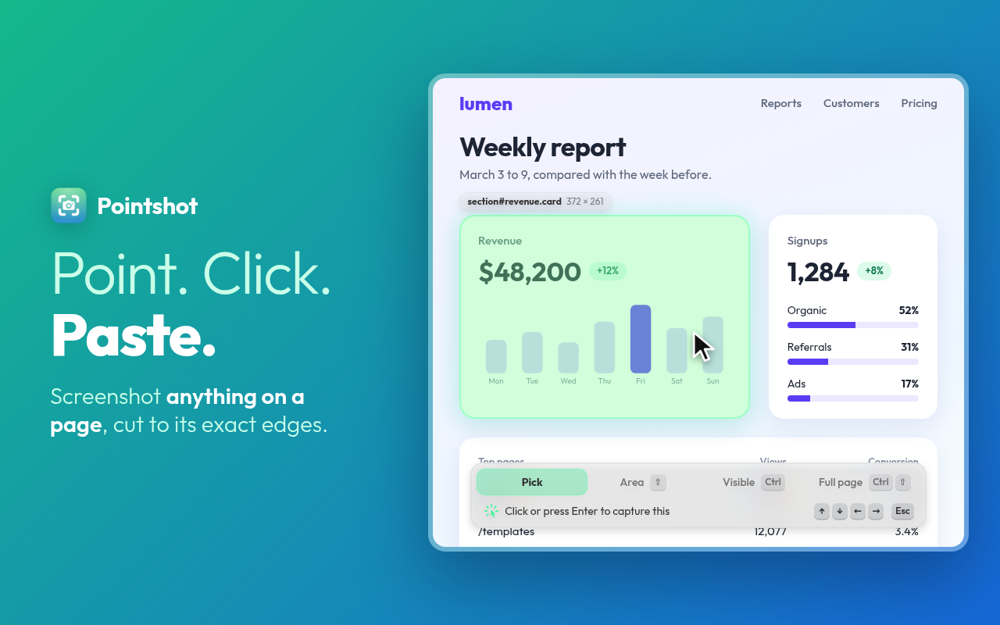

# Pointshot

Point at anything on a page and click to screenshot it: the image is in your
clipboard. Every screenshot is also kept in the popup, where you can search
it, open it full size, mark it up, copy it again or download it.



Pointshot speaks English and Argentinian Spanish, follows the browser's
language, and runs on Chrome and on Firefox 127 or later.

## Use

| Action                             | How                                                    |
| ---------------------------------- | ------------------------------------------------------ |
| Open the popup                     | Click the toolbar icon, or press `Alt+S`               |
| Start capturing                    | Press **Capture** in the popup, or press `Alt+Shift+S` |
| Select the parent / child          | `↑` / `↓` while picking                                |
| Select the previous / next sibling | `←` / `→` while picking                                |
| Capture the selected element       | Click, or press `Enter`                                |
| Capture an area                    | Hold `Shift` and drag over the page                    |
| Capture the page in view           | Press `Cmd` + `Enter`, or `Ctrl` + `Enter` off macOS   |
| Capture the full page              | The same, with `Shift` held                            |
| Cancel                             | `Esc`                                                  |
| Open a screenshot full size        | Hover it in the popup and press the arrows             |
| Mark a screenshot up or crop it    | Press the pencil in the full size view                 |
| Undo a deletion                    | Press **Undo** in the popup within five seconds        |
| Change the settings                | Press the gear in the popup                            |

The toast at the bottom of the page follows the keys you hold and shows which
capture is next. Its buttons pin a mode for a mouse-only capture.

The area, window and page captures also have keyboard commands, unassigned
by default. Set them where the browser keeps extension shortcuts, which the
options page links to.

Elements taller or wider than the window are captured whole: Pointshot scrolls
the page, captures it piece by piece and stitches the pieces together. Fixed
and sticky elements that would repeat or cover the element are hidden
meanwhile. Rounded corners come out transparent.

Elements inside a scrolling container are captured whole too, and so is a
picked scrolling container: Pointshot lays it out at its full size for the
capture and puts the page back afterwards. Pointshot also picks inside open
shadow roots and same-origin frames.

## Settings

The options page sets the resolution of screenshots, the download format and
quality, a download folder and whether to ask where to save, how many
screenshots to keep, and the theme. A download folder and the Save As dialog
need the downloads permission, which Pointshot asks for when you turn either
on.

**Copy diagnostics** puts the version, the browser, the settings and the
recent errors on the clipboard, to paste into a bug report. It includes no
page addresses.

## Limits

- Content hidden by `overflow: hidden` stays hidden, and an element inside a
  fixed or sticky container is captured as far as it is visible.
- Elements inside a cross-origin frame cannot be picked: the frame is
  captured as a whole. An element inside a same-origin frame is captured as
  far as the frame shows it.
- Screenshots larger than 12 megapixels are scaled down to fit, and the toast
  says so.
- Chrome allows two captures a second, so a long element takes a moment.
- Browsers expose the clipboard only on `https` pages. On plain `http` pages
  the screenshot is saved in the popup but not copied.
- Copies are always PNG, the only image format the clipboard takes. The
  format setting applies to downloads.
- Pages that refuse extensions, like `chrome://` pages and the Web Store,
  show `!` on the toolbar icon instead.

## Develop

```sh
bun install
bun run dev        # Chrome with hot reload
bun run check      # typecheck + lint
bun run build      # production build in build/chrome-mv3
bun run test:unit  # unit tests
bun run test       # end-to-end tests against an e2e build in build/chrome-mv3-e2e
bun run bundle:all # zips for Chrome and Firefox

mise run firefox:lint       # lint the Firefox build with web-ext
mise run firefox:run        # try the Firefox build in a temporary profile
mise run store:screenshots  # store images in store/screenshots
```

Playwright cannot load extensions into Firefox, so
`store/firefox-checklist.md` lists what to check there by hand. The store
listing copy is in `store/listing.md`, which also says how its images are
made.

## Install a release

On Chrome:

1. Download `pointshot-<version>-chrome-mv3.zip` from the releases page and
   unzip it.
2. Open `chrome://extensions` and turn on **Developer mode**.
3. Click **Load unpacked** and select the unzipped folder.

On Firefox, for a session:

1. Download `pointshot-<version>-firefox-mv2.zip` from the releases page.
2. Open `about:debugging#/runtime/this-firefox`.
3. Click **Load Temporary Add-on** and select the zip.
